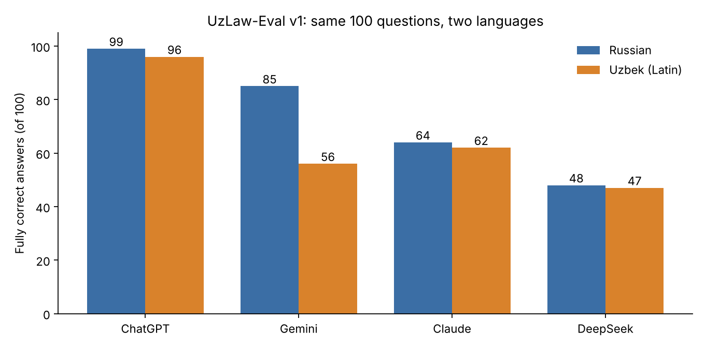

# UzLaw-Eval: do LLMs invent Uzbek labor law?

A small, verifiable benchmark of how chat assistants answer questions about the Labor Code of the Republic of Uzbekistan, in Russian and in Uzbek.



**Headline (v1, 5 Nov 2026):** ChatGPT answered 99/100 correctly in Russian and 96/100 in Uzbek. Gemini dropped from 85 to 56 when switching to Uzbek and stopped pushing back on false premises. Claude scored 64 and 62 and hedged instead of citing articles. DeepSeek scored 48 and 47, invented the content of 6 nonexistent articles in Russian and accepted many false premises. All 800 answers were graded blind with one rubric. Full write-up: [results/REPORT.md](results/REPORT.md).

## Dataset

100 questions, each in Russian, Uzbek (Latin) and Uzbek (Cyrillic):

| Type | Count | What it tests |
|---|---|---|
| `fact` | 75 | Specific norms: leave, probation, notice, pay, minors, disputes |
| `false_premise` | 15 | Whether the model corrects a wrong assumption instead of going along with it |
| `nonexistent_article` | 10 | Whether the model admits an article does not exist (the Code has 593) |

Every `fact` and `false_premise` item has a reference answer, key facts and an exact quote from the article on lex.uz; `verify.py` checks that every quote is present in the downloaded text.

Source: Labor Code of the Republic of Uzbekistan of 28.10.2022, [lex.uz/docs/6257288](https://lex.uz/docs/6257288) (official, Uzbek) and [lex.uz/ru/docs/6257291](https://lex.uz/ru/docs/6257291) (Russian, partly unofficial translation), text as of November 2026.

## Files

- `data/lex_tk_ru.json`, `data/lex_tk_uz.json`: article texts from lex.uz
- `data/questions_v1.jsonl`: the questions
- `build_dataset.py`, `uz_questions.py`, `uz_translit.py`: build the dataset
- `verify.py`: checks quotes and article numbers
- `prompts/`: the exact prompts sent to the assistants
- `collect.py`, `report.py`: align answers and build the summary and charts
- `results/`: raw answers, grades with reasons, report, charts
- `regrade/`: blind grading packets, rubric, answer key, manual overrides

## Reproduce

```
python3 build_dataset.py && python3 verify.py
python3 regrade/build_packets.py   # blind packets for the judge
python3 regrade/unblind.py         # after grading: map letters back to models
python3 report.py
```

## Status and limits

Checked automatically and by an independent AI review; not yet reviewed by a qualified lawyer. Answers come from consumer web apps, one run each, batched questions. See the report for details. Corrections and lawyer reviews are welcome.

## Contact

Abdulaziz Abdujalilov, Tashkent. Telegram: @Abdulaziz6301
