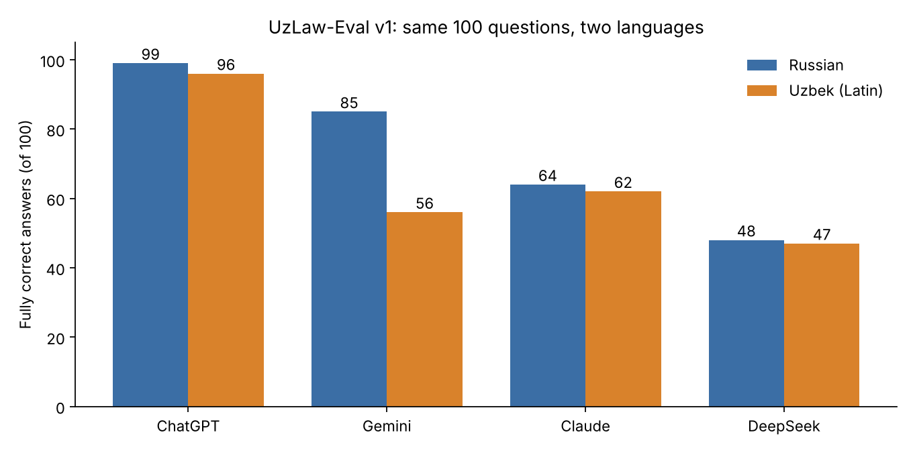

# UzLaw-Eval v1: do chat assistants know Uzbek labor law?

**Date:** 5 November 2026. **Author:** Abdulaziz Abdujalilov.

100 questions on the Labor Code of the Republic of Uzbekistan were asked in two languages, Russian and Uzbek (Latin script), through the consumer web apps of four assistants. The set has 75 factual questions, 15 questions with a false premise and 10 questions about articles that do not exist. Every reference answer is backed by an exact quote from lex.uz. All 800 answers were graded blind (model names hidden) by LLM judges with the full text of the Code and one shared rubric.

| Assistant (web) | Lang | Fully right | Partly right | Wrong | Invented norm or accepted false premise | Cited article correct |
|---|---|---|---|---|---|---|
| ChatGPT (Plus, reasoning "high") | RU | **99** | 1 | 0 | 0 | 69 of 70 |
| | UZ | **96** | 3 | 1 | 0 | 56 of 58 |
| Gemini (free, "Auto") | RU | **85** | 8 | 7 | 0 | 73 of 90 |
| | UZ | **56** | 19 | 22 | 3 | 32 of 85 |
| Claude (Opus 5.5, effort "high", incognito) | RU | **64** | 8 | 27 | 1 | never cited |
| | UZ | **62** | 10 | 27 | 1 | never cited |
| DeepSeek (DeepThink on, search off) | RU | **48** | 13 | 27 | 12 | 2 of 43 |
| | UZ | **47** | 18 | 28 | 7 | 0 of 25 |

"Fully right" = correct fact, corrected false premise, or "no such article" for a nonexistent one. All 800 answers were graded blind by one rubric (see Method).

## Findings

1. **Language matters a lot for one model and not at all for others.** Gemini lost 29 points when the same questions were asked in Uzbek, and its share of correct article numbers fell from 81% to 38%. ChatGPT lost 3 points. Claude lost 2.
2. **In Uzbek, Gemini stopped pushing back.** In Russian it corrected 12 of 15 false premises and accepted none; in Uzbek it corrected 5 and accepted 3 (a 1-month deadline to sue for reinstatement, a 2-year disciplinary sanction, a 9-hour day on a five-day week). It also said "no such article" for only 3 of 10 nonexistent articles in Uzbek, against 10 of 10 in Russian; the rest were vague "I don't remember this article".
3. **Wrong answers usually look like another country's law.** 120 hours of overtime a year, double pay for every overtime hour, a "remark" as a sanction, light work from age 14: these match the old Uzbek code or the Russian Labor Code, not the current Uzbek one. Recent amendments (overtime rules changed in November 2025) were missed by Gemini, Claude and DeepSeek.
4. **Right content, wrong article number.** Many of Gemini's citations point 1 to 4 articles away from the actual norm. For a lawyer this is a real risk: the answer looks verifiable, but the reference sends you to the wrong place.
5. **Refusals were backed by stale facts.** Most refusals said the Code has 581 or 583 articles. The current version has 593 (articles 582 to 593 were added on 11 June 2026).
6. **DeepSeek invented articles and agreed with wrong premises most often.** In Russian it described the content of 6 of the 10 nonexistent articles (for example, the "rights of remote workers" in Article 612) and accepted 6 of 15 false premises; in Uzbek it accepted 7. Its article numbers mostly came from the old 1995 code: 2 of 43 citations were right in Russian, 0 of 25 in Uzbek.
7. **One false premise fooled almost everyone.** "The deadline to sue for reinstatement is one month" is the old rule (now three months, Art. 560). Claude in both languages, Gemini in Uzbek and DeepSeek in both languages went along with it.
8. **Abstention is not the same as being right.** Claude hedged often and never cited an article number, but 27 of its 75 factual answers were wrong in each language. Calibration, not just accuracy, is worth measuring.

## A side finding about the source text

The Russian text on lex.uz is an unofficial translation; the official text is Uzbek. They can differ: for overtime pay, the official Uzbek Art. 262 says "the first two hours *in a day*", while the Russian translation says only "the first two hours". Benchmarks built on translations should check the official text.

## Method and limits

- Consumer web apps, not APIs: system prompts, memory and model routing are outside our control and change over time. ChatGPT used a temporary chat, Claude an incognito chat, Gemini and DeepSeek regular chats.
- Different tiers: ChatGPT Plus with reasoning, free Gemini, Claude Opus with high effort, free DeepSeek with DeepThink.
- Questions were sent in batches of 10 to 50 per message, with an instruction not to search the web. One run per model and language.
- Grading: for each question all 8 answers (4 models × 2 languages) were shown side by side under random letters, with the reference answer and the article text in Russian and official Uzbek, to one judge using one rubric (`regrade/RUBRIC.md`). Each grade has a written reason in `graded_*.jsonl`. 3 of 800 grades were adjusted by hand for consistency (`regrade/overrides.json`). Borderline cases (mostly `partially_correct` vs `correct`) remain a judgment call. The dataset itself was checked automatically (all quotes match lex.uz) and by an independent AI review, but not yet by a qualified lawyer.
- The Uzbek questions are my translations using the terminology of the official text.

## Files

- `data/questions_v1.jsonl`: questions (RU, UZ Latin, UZ Cyrillic), reference answers, key facts, quotes.
- `results/raw_*`: raw model answers. `results/answers_*.jsonl`: answers aligned to questions. `results/graded_*.jsonl`: grades with reasons. `results/summary.json`: the table above.
